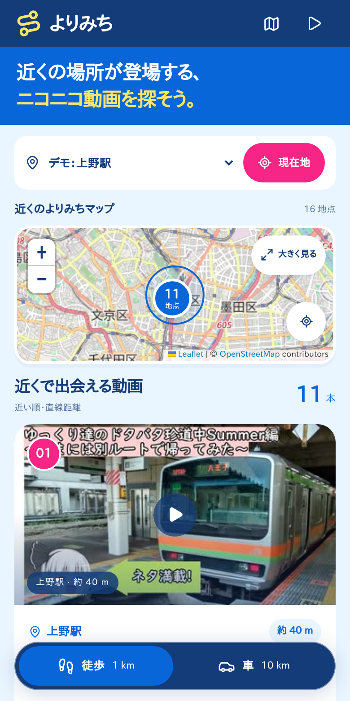
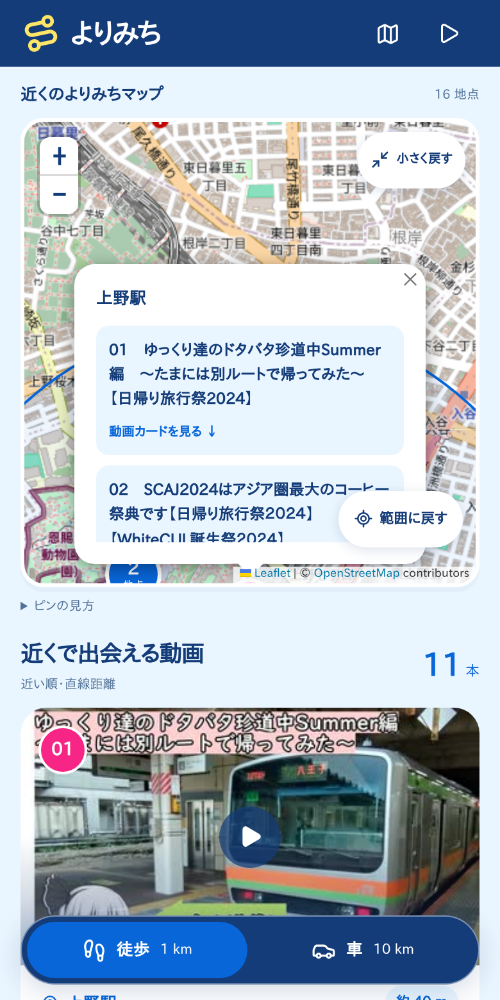
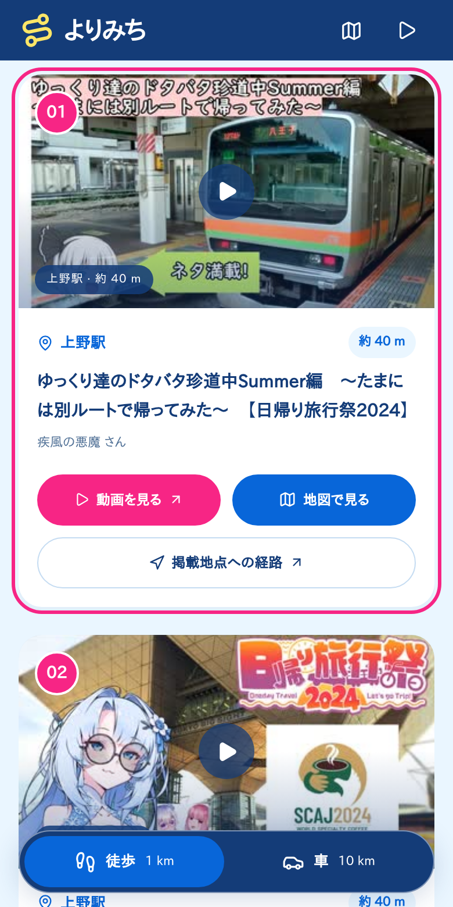

<!-- _class: cover -->

# よりみち

## 動画のつづきは、街で。

現在地の近くで、
動画に登場した景色や体験を見つける。

2026.10 HACKATHON / テーマ「次のメディア」

<!--
15 秒 / 累計 0:15
「よりみち」は、動画に登場した場所を現在地の近くから見つける Web アプリです。
今回の「次のメディア」を、動画を見る時間から街での体験につながるものとして考えました。
-->

---

<!-- _class: problem -->

## 「行ってみたい」を、今日のきっかけに

# 動画で見た景色が、
# 近くにあるかもしれない。

- 旅行やごはんの動画には、**追体験したくなる場所**がある
- でも、その場所が今いる街の近くかは分かりにくい
- **現在地 × 動画**から、身近な発見を届けたい

<!--
30 秒 / 累計 0:45
旅行やごはんの動画を見て、同じ体験をしてみたいと思うことがあります。
一方で、その場所が今いる街の近くにあるかは、動画を眺めるだけでは分かりません。
そこで動画と現在地を結びつけ、いつもの街での小さな発見に変えることを目指しました。
目的地を決めてから検索する前に、動画を眺めながら出かけるきっかけを作ります。
-->

---

<!-- _class: experience -->

## 近くの動画を眺めて、街へ

1. **絞る**
   現在地と徒歩 / 車で検索
2. **眺める**
   近い順の動画をスクロール
3. **行く**
   登場地点を確認し、経路へ

ピンとカードは共通の番号。
地図には検索範囲の地点だけ。

<!--
35 秒 / 累計 1:20
操作は、絞る、眺める、行くの三つです。
初回表示で現在地を取得し、取得できなければデモ地点で試せます。
下部のセレクターで、徒歩なら半径 1 km、車なら 10 km の動画を近い順に表示します。
地図には該当する地点だけを出し、動画一覧は縦にスクロールして眺められます。
ピンとカードを行き来して地点名を確認し、動画の視聴や Google マップの経路検索へ進めます。
-->

---

<!-- _class: data -->

## 「動画旅マップ」を、現在地の近くへ

# 349 本 / 882 地点

- 既存の [ニコニコ「動画旅マップ」](https://www.google.com/maps/d/viewer?mid=13Xyxidjdp-PCcwAl2zI76WBqUSOKkX95) から関東周辺を抽出
- 同じ動画の複数地点は **1 枚のカード**に集約
- 元マップに紐づく施設情報から、**201 地点の名称**を補完

現在のプロトタイプの収録数。
検索距離は直線距離で、移動時間は経路検索で確認。

<!--
30 秒 / 累計 1:50
土台には、ニコニコの旅行動画と登場地点を結びつけた、既存の動画旅マップを使っています。
今回取り込んだ関東周辺のデータは 349 本、882 地点です。
同じ動画に複数の地点があってもカードは一つにまとめ、最寄りの地点から並べています。
施設 ID に一致する名称を確認できた 201 地点には地点名も表示し、未取得の地点は掲載座標として扱います。
-->

---

<!-- _class: architecture -->

## 静的配信だけで動くプロトタイプ

### データ更新・ビルド時

> 元マップ・動画情報 → JSON → 静的ファイル

### 閲覧時

> ブラウザ内で位置取得・近隣検索・地図表示
> → ニコニコ動画 / Google マップ

**自前の API サーバー・DB は不要。**
TypeScript / TanStack Start / Panda CSS / Leaflet

<!--
30 秒 / 累計 2:20
動画や地点の情報は更新時に JSON へ取り込み、ビルドした静的ファイルと一緒に配信します。
近くの動画を探す処理はブラウザ内で完結するので、実行時に自前の API サーバーやデータベースは必要ありません。
背景地図は OpenStreetMap、サムネイルはニコニコから取得します。
動画視聴と経路検索にはそれぞれの既存サービスを使い、小さい構成で一連の体験を作っています。
-->

---

<!-- _class: demo -->

## DEMO — 上野から、よりみち

1. 徒歩 **1 km**：近くの **11 本**を眺める
2. カード → 地図：登場地点を確認
3. **掲載地点への経路**を開く
4. 車 **10 km**：範囲を広げて **47 本**へ

位置情報の許可なしでも、デモ地点で試せます。

<!--
導入 10 秒 / スライド説明の累計 2:30
では、上野駅から探す場面をお見せします。
徒歩圏の動画を眺めて地点と経路を確認し、最後に車の範囲へ広げます。

ここでブラウザに切り替える。
実演は約 90 秒。
詳しい操作と時間配分は docs/README.md を参照。
-->

---

<!-- _class: closing -->

# いつもの街に、
# 知らなかったつづきを。

## 動画 → 発見 → よりみち

次に試すこと：実機での外出体験・収録エリアの拡張

<!--
25 秒 / スライド説明の合計 2:55、デモ込み約 4:25
動画に登場した場所を近くから知ることで、いつもの街の見え方が少し変わると考えています。
次は実機で外出時の使いやすさを確かめ、収録エリアも広げたいです。
見るだけで終わらず、街での体験につながるメディアとして、「よりみち」を提案します。
-->
